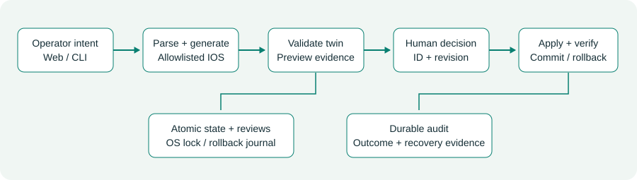
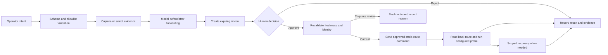

# PS-008 Network Management Agent

**AIORI-3 hackathon project | Track: PS-008 | Submission repository: A3-PS008-TC168**

An explainable, approval-gated assistant for planning and reviewing IPv4 static-route changes. Operators can inspect the predicted forwarding impact, review the exact proposed action, and retain control over approval. The project combines a deterministic three-router software twin with a GNS3/Cisco IOS adapter and a local dashboard.

## AIORI-3 Abstract

### Problem description

Router changes require careful address, next-hop, and path planning. This project makes a supported static-route change easier to inspect before approval and provides a review trail for the decision and result.

The prototype focuses on a practical network-management workflow: express an IPv4 static-route intent, validate it against a model of the network, show the before-and-after forwarding paths, approve or reject the candidate, and verify supported outcomes. Its scope is intentionally clear and demonstrable.

## AIORI-3 Background

An IPv4 route associates a destination prefix with a directly connected interface or next hop. Routers use prefix matching to choose a route; the software twin models longest-prefix forwarding for its supported static-route scenarios. CIDR notation such as `10.20.0.0/24` expresses the destination network and prefix length.

The example topology connects Operations, Core, and Engineering through R1, R2, and R3. A proposed route on R1 via R2 changes the modeled path toward the Engineering LAN. The lab documentation also explains return paths, interface state, and endpoint addressing for real connectivity checks.

### Project objectives

- Show route impact before a change is approved.
- Keep a human decision at the deployment boundary.
- Validate requests and captured state within the supported scope.
- Verify route changes with route read-back and configured endpoint probes.
- Record operation evidence and recovery outcomes for review.

## AIORI-3 Literature & RFC Review

- [RFC 1812: Requirements for IP Version 4 Routers](https://www.rfc-editor.org/rfc/rfc1812) provides the IPv4 routing foundation used by the project’s network model.
- [RFC 4632: Classless Inter-domain Routing (CIDR)](https://www.rfc-editor.org/rfc/rfc4632) describes CIDR prefixes, which are used in route requests and forwarding analysis.
- [GNS3 documentation](https://docs.gns3.com/) describes the simulator and controller used for isolated network labs.
- [Netmiko](https://github.com/ktbyers/netmiko) provides SSH-based network-device interaction used by the IOS adapter.

The project brings these concepts into an operator-centered workflow: structured intent, modeled impact, fresh evidence, explicit approval, and outcome verification.

## AIORI-3 Proposed Solution

The application provides two complementary ways to explore network changes:

1. **Software twin:** a deterministic R1-R2-R3 model drives the dashboard demo. It checks route proposals against modeled forwarding and supports repeatable scenarios without router images.
2. **GNS3/Cisco IOS adapter:** implements controller and device evidence capture, a restricted IOS route parser, modeled impact previews, approved static-route commands, state revalidation, route read-back, configured probes for additions, operation journaling, and scoped recovery outcomes.

The supported intents are `add_static_route` and `remove_static_route`. Route removal is limited to routes added and verified by the application. The adapter uses command allowlisting and verified SSH host keys. The dashboard presents modeled predictions separately from captured device evidence.

### AIORI-3 Solution Architecture



The shared workflow and network model use Python. FastAPI/Uvicorn serve the local web/API service; Jinja2 and vanilla JavaScript power the dashboard. Pytest, HTTPX, and Playwright support automated verification. Netmiko and the GNS3 controller API support the optional live-lab adapter.

### Data Flow Diagram



## AIORI-3 Solution Optimization

| Area | Direct/manual workflow | Project workflow |
|---|---|---|
| Change proposal | Console-oriented command entry | Structured route intent |
| Impact visibility | Operator traces paths manually | Before/after modeled forwarding preview |
| Approval | Separate operational step | Explicit, expiring, single-use review |
| Safety checks | Procedure-dependent | Prefix, next-hop, conflict, loop, identity, and freshness checks |
| Execution | Open-ended command entry | Allowlisted static-route command after approval |
| Verification | Review command response | Route read-back and configured endpoint probe for additions |
| Recovery and evidence | Manual reconstruction | Operation journal with scoped recovery outcome |

## AIORI-3 Implemented Features and Evidence

- **127 automated tests pass**, covering simulator behavior and mocked GNS3 controller/device workflows.
- The local dashboard supports repeatable judge-demo scenarios, route preview, approval/rejection, audit review, and evidence export.
- The software twin models a three-router topology and checks forwarding impact across relevant prefix ranges.
- The GNS3 controller was discovered through the dashboard on the development laptop.
- Two VPCS endpoints in an isolated GNS3 smoke lab exchanged ping replies across their virtual link.
- The IOS adapter implements a restricted, approval-gated IPv4 static-route workflow with state checks, read-back, configured probes, and conservative recovery states.

The automated test result, controller observation, and VPCS connectivity check are distinct evidence types and are labeled accordingly in the project documentation.

## AIORI-3 Deployment Timeline

| Milestone | Project result |
|---|---|
| Three-router software twin and dashboard | Implemented and covered by automated tests |
| Review lifecycle, approval/rejection, audit, and simulator recovery | Implemented and tested |
| GNS3 controller discovery | Observed locally through the dashboard |
| GNS3 VPCS link connectivity | Demonstrated with live ping replies |
| IOS-compatible route operations | Adapter workflow implemented; live-lab validation is a future milestone |

## Future Scope

- Validate agent-driven route addition, read-back, endpoint probes, owned-route removal, and scoped recovery in an isolated three-router IOS-compatible GNS3 lab.
- Extend the network model and device workflow to support IPv6 static routes and dual-stack scenarios.
- Add optional natural-language intent interpretation with secure API-key handling, schema validation, and evaluation tests.
- Expand supported device platforms and route formats through independently tested adapters.
- Strengthen operation evidence with durable, tamper-evident audit storage and broader operational testing.
- Add the team’s YouTube demonstration link and presentation PDF when those materials are provided.

## Run and Test

From the repository root in Windows PowerShell:

```powershell
cd src
python -m venv .venv
.\.venv\Scripts\python.exe -m pip install -e ".[dev]"
.\.venv\Scripts\python.exe -m ps008 --web
```

Open `http://127.0.0.1:8000`, select **Judge demo**, inspect the proposed route and modeled paths, then approve or reject it.

Run the automated tests:

```powershell
cd src
.\.venv\Scripts\python.exe -m pip install -e ".[dev,gns3]"
.\.venv\Scripts\python.exe -m pytest -q
```

For GNS3 lab setup and the supported workflow, see [`src/docs/GNS3_SETUP.md`](src/docs/GNS3_SETUP.md). The judge walkthrough is in [`src/docs/DEMO.md`](src/docs/DEMO.md), and security boundaries are documented in [`src/docs/SECURITY.md`](src/docs/SECURITY.md).

## Bibliography

1. F. Baker, [RFC 1812: Requirements for IP Version 4 Routers](https://www.rfc-editor.org/rfc/rfc1812), IETF, June 1995.
2. V. Fuller and T. Li, [RFC 4632: Classless Inter-domain Routing (CIDR): The Internet Address Assignment and Aggregation Plan](https://www.rfc-editor.org/rfc/rfc4632), IETF, August 2006.
3. [GNS3 Documentation](https://docs.gns3.com/), GNS3 project documentation.
4. [Netmiko](https://github.com/ktbyers/netmiko), Python library for network-device SSH interaction.

## Source Code

The runnable application, tests, examples, and technical guides are organized under [`src/`](src/), following the supplied hackathon template. The original template is preserved at [`Proposed-structure-hackathon.pdf`](Proposed-structure-hackathon.pdf).
