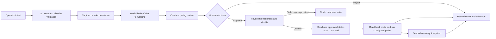

# PS-008 Network Management Agent

**AIORI-3 hackathon project | Track: PS-008 | Submission repository: A3-PS008-TC168**

An explainable, approval-gated assistant for planning and reviewing IPv4 static-route changes. It lets an operator describe a supported change, inspect predicted forwarding impact, and approve or reject the exact candidate before deployment. A deterministic software network twin is ready for repeatable demos. A separate GNS3/Cisco IOS adapter is implemented and offline-tested; live IOS route deployment is not yet verified.

> **Evidence boundary:** 127 automated tests pass. Local GNS3 controller discovery and a two-VPCS connectivity smoke test were observed. These do not prove the agent can configure a router. No successful end-to-end approved IOS route change has been observed. See [what is verified](#implementation-status-and-evidence).

## AIORI-3 Abstract

### Problem description

Network changes are often typed directly into router consoles. A wrong prefix, next hop, or device can interrupt connectivity, and the operator may not see the forwarding impact until after the change. Reviewers also need a clear record of what was proposed, why it was safe, who approved it, and whether it actually worked.

This project explores a safer workflow for the narrow but teachable case of IPv4 static routes. It converts a structured operator intent into a bounded candidate, predicts paths before deployment, requires a human decision, and records validation and outcome evidence. The initial demonstration uses a three-router lab and intentionally does not claim to automate general network configuration.

## AIORI-3 Background

An IPv4 route associates a destination prefix with a directly connected interface or a next hop. Routers choose a route from their routing information using prefix matching; the project models longest-prefix forwarding for its supported static-route scenarios. CIDR notation such as `10.20.0.0/24` expresses a network prefix and its length.

In the example topology, R1, R2, and R3 connect Operations, Core, and Engineering LANs. R1 initially has no route to Engineering. A proposed route on R1 via R2 may restore the modeled path, but a predicted path is not the same as a real packet test. In a physical or virtual lab, return routes, interfaces, addressing, and endpoint state also affect reachability.

### Project objectives

- Make the proposed route and its predicted impact visible before a router write.
- Keep the human operator in control with an explicit, single-use approval or rejection.
- Revalidate captured state before execution and block stale or unsupported changes.
- Verify a supported change by reading back the route and, for additions, checking a configured endpoint probe.
- Keep simulated, mocked, controller-observed, and device-observed results distinct.

## AIORI-3 Literature & RFC Review

- [RFC 1812: Requirements for IP Version 4 Routers](https://www.rfc-editor.org/rfc/rfc1812) describes IPv4 router behavior and requirements. It grounds the routing and forwarding concepts used in the project; this prototype implements only a small, explicit subset and is not a complete RFC conformance implementation.
- [RFC 4632: Classless Inter-domain Routing (CIDR)](https://www.rfc-editor.org/rfc/rfc4632) describes CIDR address assignment and aggregation. Prefix notation is used by the route request schema and the software twin.
- [GNS3 documentation](https://docs.gns3.com/) describes the network simulator used as the intended isolated lab. GNS3 supplies the lab/controller environment; it is not itself the project’s change-review agent.
- [Netmiko](https://github.com/ktbyers/netmiko) provides the SSH-based network-device interaction used by the optional IOS adapter. The adapter restricts which commands it may send and requires host-key verification.

These standards and tools provide the routing and lab foundations. The project’s main contribution is the application-level review lifecycle: bounded intent, impact preview, freshness checks, human approval, verification, and visible recovery outcomes.

## AIORI-3 Proposed Solution

The application has two separate execution paths:

1. **Software twin:** a deterministic R1-R2-R3 model supports a fast, repeatable dashboard demonstration without router images. It validates route changes against modeled forwarding and keeps demo scenarios isolated from persistent lab state.
2. **GNS3/IOS adapter:** captures configured controller and router evidence, parses a narrow supported IOS output subset, previews a structured route change, and requires approval before an allowlisted static-route command can be sent. It rechecks state, reads back the route, runs a configured probe for an addition, and records recovery/unknown outcomes rather than claiming success when state cannot be confirmed.

Only `add_static_route` and `remove_static_route` are in scope. Route removal is limited to routes the application previously added and verified. Unsupported route output, missing devices, stale evidence, unknown SSH host keys, or invalid next hops block the live path. The optional OpenAI language interface is deferred; no LLM or API key is used in this version.

### AIORI-3 Solution Architecture


The application uses Python for the shared workflow and network model, FastAPI/Uvicorn for the local web/API service, Jinja2 and vanilla JavaScript for the dashboard, and Pytest/HTTPX/Playwright for verification. Netmiko and the GNS3 controller API are optional components for the lab adapter.

### Data Flow Diagram



The modeled path and device evidence are labeled separately in the GNS3 dashboard. A controller inventory response alone is not device verification.

## AIORI-3 Solution Optimization

| Area | Direct/manual baseline | Project workflow |
|---|---|---|
| Change proposal | Operator enters commands at a router | Structured intent creates a bounded candidate |
| Impact visibility | Often checked after configuration | Before/after modeled forwarding preview |
| Approval | Informal or outside the command flow | Explicit review with expiry and single-use decision |
| Safety checks | Depends on operator procedure | Prefix, next-hop, conflict, loop, identity, and freshness checks within supported scope |
| Execution | Free-form CLI | Allowlisted IPv4 static-route command after approval only |
| Verification | Operator may rely on command prompt | Route read-back; configured endpoint probe for additions |
| Recovery/audit | May be manual and difficult to reconstruct | Operation journal and scoped recovery status; local journal is not tamper-proof |

This is a process and safety improvement prototype, not a benchmarked claim of reduced outage rates or production-grade automation.

## AIORI-3 Implementation Status and Evidence

- **Automated tests:** 127 tests passed in the local repository test run, including simulator behavior and mocked GNS3 controller/device workflows.
- **Controller-observed:** the development laptop’s GNS3 controller was discovered through the dashboard.
- **Lab connectivity observed:** two VPCS nodes in an isolated GNS3 smoke project returned ping replies across their link.
- **Not device-observed:** no successful approved route change by this agent against a Cisco IOS-compatible router has been verified. An OpenWrt image is not supported by the IOS-specific parser/command adapter.
- **Not production-ready:** testing is limited, the operation journal is local JSON (not signed/tamper-proof), and only the stated static-route scope is supported.

Judges should evaluate the simulator as the reproducible demo and treat the GNS3 IOS write path as implemented but awaiting live-lab validation. Do not describe controller discovery, VPCS ping, mocks, or modeled forwarding as proof of router deployment.

## AIORI-3 Deployment Timeline

| Milestone | Status | Evidence / next gate |
|---|---|---|
| Deterministic three-router software twin and dashboard | Complete | Repeatable local demo and automated tests |
| Review lifecycle, approval/rejection, audit, and simulator recovery | Complete | Covered by automated tests and judge-demo scenarios |
| GNS3 controller discovery and isolated VPCS smoke lab | Demonstrated locally | Controller/node observation and VPCS ping; not IOS deployment |
| IOS-compatible three-router lab, SSH host keys, route add/read-back/probe | Pending | Requires a permitted IOS-compatible image and configured management/data planes |
| Owned-route removal and live recovery verification | Pending | Run only after the live add flow and route ownership are validated |
| Optional LLM intent interface | Deferred | Add only with secure key handling, schema validation, and dedicated evaluation |

## Run and Test

From the repository root:

```powershell
cd src
python -m venv .venv
.\.venv\Scripts\python.exe -m pip install -e ".[dev]"
.\.venv\Scripts\python.exe -m ps008 --web
```

Open `http://127.0.0.1:8000`, select **Judge demo**, and inspect a proposed route before approving it. For the optional GNS3 adapter, follow [`src/docs/GNS3_SETUP.md`](src/docs/GNS3_SETUP.md); its live IOS prerequisites are not bundled in this repository.

Run the test suite:

```powershell
cd src
.\.venv\Scripts\python.exe -m pip install -e ".[dev,gns3]"
.\.venv\Scripts\python.exe -m pytest -q
```

See [`src/docs/DEMO.md`](src/docs/DEMO.md) for the judging walkthrough and [`src/docs/SECURITY.md`](src/docs/SECURITY.md) for security boundaries.

## Submission Media

- **Team demonstration video (YouTube):** Not supplied yet. Add the final public/unlisted URL here when the team provides it.
- **Presentation PDF:** Not supplied yet. Add the approved PDF export here when the team provides it.

No link or presentation PDF is fabricated or inferred from other files. The original hackathon structure template is preserved at [`Proposed-structure-hackathon.pdf`](Proposed-structure-hackathon.pdf).

## Bibliography

1. F. Baker, [RFC 1812: Requirements for IP Version 4 Routers](https://www.rfc-editor.org/rfc/rfc1812), IETF, June 1995.
2. V. Fuller and T. Li, [RFC 4632: Classless Inter-domain Routing (CIDR): The Internet Address Assignment and Aggregation Plan](https://www.rfc-editor.org/rfc/rfc4632), IETF, August 2006.
3. [GNS3 Documentation](https://docs.gns3.com/), GNS3 project documentation.
4. [Netmiko](https://github.com/ktbyers/netmiko), open-source Python library for network-device SSH interaction.

## Source Code

The runnable application, tests, examples, and technical documentation are organized under [`src/`](src/), as requested by the supplied hackathon template. Start with [`src/README.md`](src/README.md).
