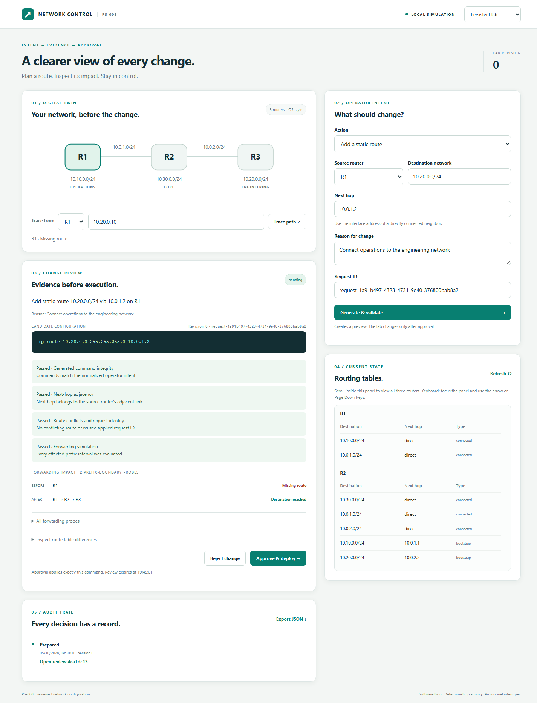
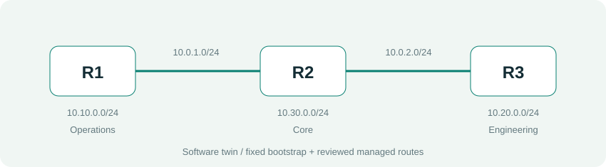

# PS-008 Network Management Agent

[Project understanding and Proposed solution](https://youtu.be/tZcXjvHfEpg?si=Nb0RlGkdUhJWbuEH) · [Prototype demonstration link](https://drive.google.com/drive/folders/1gVgXb2LjOvwtVQpNY_jxOXl32ayPishS?usp=drive_link)

A local dashboard and CLI for reviewed IPv4 static-route changes. The software-twin demo remains available, and `/gns3` provides a separate, approval-gated GNS3/IOS adapter with device read-back, endpoint probing, drift checks, an operation journal, and scoped recovery.



## Start the application

Python 3.10+, Git, and a browser are required. Run from the repository root in PowerShell:

```powershell
python -m venv .venv
.\.venv\Scripts\python.exe -m pip install -e ".[dev,report]"
.\.venv\Scripts\python.exe -m ps008 --web
```

Open http://127.0.0.1:8000. The application binds to your computer's loopback interface. No API key or external network service is required. On macOS/Linux, use `.venv/bin/python` instead of the Windows executable.

Select **Judge demo** and choose **Add route**. Inspect the generated command and before/after forwarding paths, then select **Approve & deploy**. Try rejection, conflicts, loops, removal, deployment failure, and verification failure. Each preset resets only your session's demo lab; the persistent lab is separate.

## What works

- Two provisional intents: `add_static_route` and `remove_static_route`.
- Explicit R1-R2-R3 links, connected LANs, fixed bootstrap routes, and operator-managed routes.
- Normalized IPv4 requests and strict Cisco IOS command allowlisting.
- Preview on a cloned twin, prefix-boundary reachability checks, longest-prefix forwarding, conflict and loop detection.
- Server-issued reviews bound to a lab revision, with a 15-minute expiry and single-use approval/rejection.
- Deployment-boundary validation and post-apply verification.
- Atomic persistence, snapshots, rollback, interrupted-deployment recovery, and an exportable audit trail.
- Accessible local dashboard, responsive layout, and shared CLI/service logic.
- Typed review lifecycle shared by simulator and GNS3 review adapters.
- GNS3 dashboard for controller/device evidence, modeled preview, explicit approve/reject, and evidence export.
- Allowlisted IOS static-route add/remove commands over verified-host-key SSH; review expiry and device-state revalidation.
- Persistent device-operation journal, route ownership tracking, read-back verification, configured IPv4 probes, and conservative recovery states.

The software-twin workflow is deterministic and does not emulate IOS. The GNS3 path can issue writes only after its separate review is approved and fresh device evidence still matches. Both remain limited to explicitly supported IPv4 static routes. No LLM is connected; the OpenAI interface is deferred until the live path has real-lab validation and secure key setup.

## Is the agent working correctly?

The simulator path has transactional twin-state checks. The current full suite passes 127 tests. The live GNS3 controller was observed on this Windows machine (GNS3 2.2.61 with local Basic authentication), and the dashboard's controller-capture endpoint discovered the running OpenWrt probe node. A separate two-VPCS GNS3 smoke lab also passed five real ping replies across its GNS3 link.

These live checks validate controller discovery and GNS3 packet connectivity; they do not validate the router agent's write path. An OpenWrt image boots and a static route was manually added/read back from its console, but the IOS-only observation and command adapter does not support OpenWrt. The OpenWrt router-to-router ping did not pass, and no Cisco IOS-compatible image or reachable IOS SSH management lab is installed. Therefore live agent route deployment remains unverified and must not be presented as successful. Dynamic routes, IPv6, ECMP, arbitrary commands, and unowned-route removal are blocked. The local JSON journal is not a signed or tamper-proof compliance log.

## GNS3 lab and optional LLM

### Local OpenWrt recording lab

The `/gns3` page includes a **Live GNS3 / OpenWrt lab** panel for the isolated `AIORI-PS008-Three-Router-Lab` project created by `python tools/setup_three_router_gns3_lab.py`. It reads the started R1/R2/R3 QEMU consoles, displays their IPv4 interfaces and routes, and can run a four-packet R1-to-R3 ping. Captures retain the latest 20 results in the ignored `.ps008/openwrt-lab-captures.json` file and can be exported as JSON. The panel is read-only apart from the explicitly requested ping; it does not deploy route changes. Set `PS008_OPENWRT_PROJECT_ID` before starting the web app if your GNS3 project has a different UUID. A ping result is evidence of that run only; a green GNS3 link does not prove routed connectivity.

The GNS3 review flow is at `/gns3`. Its live write path requires an isolated three-router IOS-compatible lab, independent SSH management addresses, verified host keys, environment-based credentials, and a source-defined endpoint probe. The example inventory is a template, not a ready-to-run lab. Follow the [setup and limitations](docs/GNS3_SETUP.md); never connect this prototype to production routers.

For this machine's authenticated local GNS3 controller dashboard demo, install the adapter dependencies and start the prepared inventory using:

```powershell
.\.venv\Scripts\python.exe -m pip install -e ".[gns3]"
python tools/run_gns3_dashboard.py
```

Open http://127.0.0.1:8000/gns3 and use **Check GNS3 controller** to see the local node. This controller-only inventory is specific to the development laptop. For a separate GNS3 connectivity smoke test, run `python tools/setup_gns3_smoke_lab.py`; it records live VPCS ping evidence under `.ps008/`. Neither the smoke lab nor the OpenWrt probe proves the IOS route deployment flow. For a real deployment, prepare `.ps008/gns3-inventory.json` using the full setup guide and verify route read-back plus a configured endpoint probe. OpenAI natural-language interpretation remains deferred; no API key is needed or read by this version.

## Topology



R1 hosts `10.10.0.0/24`, R2 hosts `10.30.0.0/24`, and R3 hosts `10.20.0.0/24`. Links are `10.0.1.0/24` and `10.0.2.0/24`. Fixed bootstrap routes let R2 reach the outer LANs and R3 reach R1/R2. R1 initially has no managed route to engineering; adding `10.20.0.0/24` via `10.0.1.2` changes its path from a missing route to R1 -> R2 -> R3.

## CLI

```powershell
.\.venv\Scripts\python.exe -m ps008 --demo
.\.venv\Scripts\python.exe -m ps008 examples/add_route.json
.\.venv\Scripts\python.exe -m ps008 examples/remove_route.json
```

Interactive CLI deployment requires `yes` or `y`. Default state: `.ps008/state.json`; `--state-file PATH` selects another file. CLI and web requests share the same persisted lab and review rules. Version 1 files load compatibly and upgrade on the next write.

## Verify and reproduce evidence

```powershell
.\.venv\Scripts\python.exe -m pytest -q --junitxml=output/test-results.xml
.\.venv\Scripts\python.exe -m playwright install chromium
.\.venv\Scripts\python.exe tools/check_browser.py --screenshots
.\.venv\Scripts\python.exe tools/check_gns3_browser.py
.\.venv\Scripts\python.exe tools/build_report.py
```

If Windows denies access to Pytest's shared temporary folder, use a fresh directory: `--basetemp .pytest_cache/run-<unique-name>`. Pytest removes that directory before use, so choose a disposable test directory.

`check_browser.py` exercises the simulator's UI workflows. `check_gns3_browser.py` exercises the GNS3 dashboard and approval controls with mocked device responses; it does not contact GNS3 or prove router compatibility. The report builder reads simulator test evidence and refuses failed results or missing evidence.

## Documentation

- [Implementation and architecture](docs/IMPLEMENTATION.md)
- [HTTP API](docs/API.md)
- [Security boundaries](docs/SECURITY.md)
- [Judges' demonstration](docs/DEMO.md)
- [Theory and judge preparation](docs/JUDGE_THEORY.md)
- [Tests and evidence](docs/TEST_PLAN.md)
- [Technical report source](docs/technical-report.md)
- [Earlier technical report PDF](output/pdf/ps008-technical-report.pdf) (simulator milestone; not regenerated for GNS3)
- [Submission checklist](docs/SUBMISSION.md)

The UI and report were implemented as one integrated project. Both teammates should review the complete flow before the mentor demonstration.
