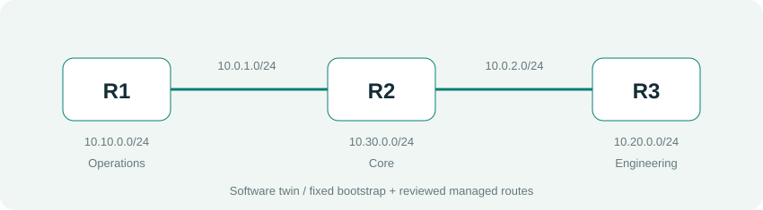
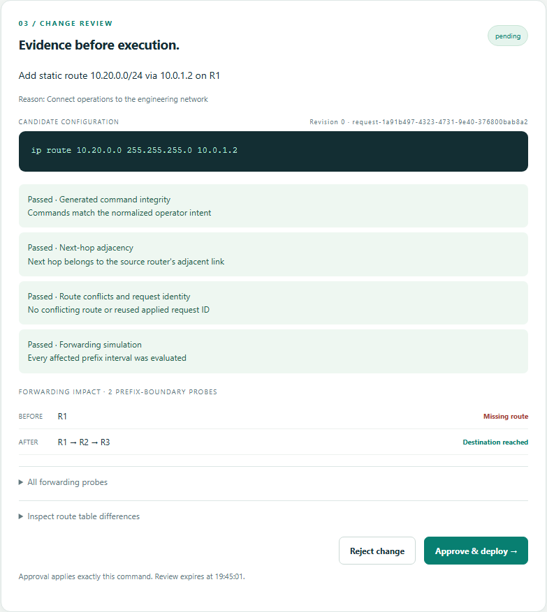
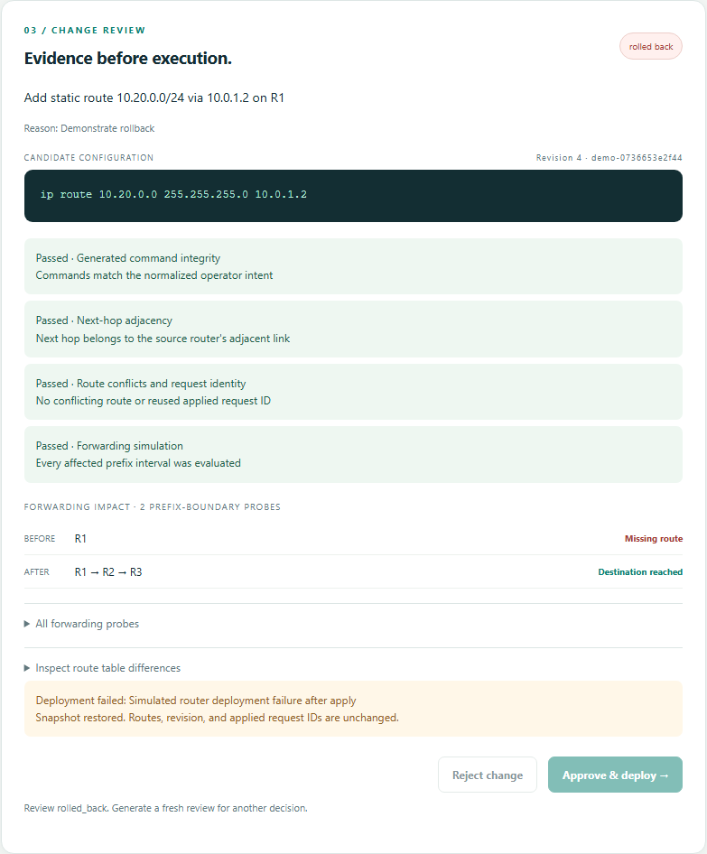

# PS-008 Network Management Agent

Technical implementation report | Parth Bhad and Aaditya Hingmire | 4 October 2026

## Abstract

Manual router changes can introduce incorrect next hops, route conflicts, forwarding loops, and outages. This deterministic agent translates a structured intent into a restricted Cisco IOS-style candidate, evaluates it in a three-router software twin, requires human approval, and deploys with verification and rollback. A local dashboard exposes exact commands, before/after forwarding paths, route tables, and audit evidence. The CLI shares the same review operations.

## Problem and objectives

The prototype focuses on two controlled IPv4 static-route intents. It includes a simulator and a separately approval-gated GNS3/IOS device adapter with a durable operation journal, strict read-back, configured endpoint probes for additions, and conservative recovery. This device adapter is offline/mock tested; no live router deployment is claimed because a configured GNS3 lab was unavailable during this implementation milestone. No LLM is connected.

## Requirements and scope

The agent must support R1-R2-R3, normalize IPv4 input, reject unsafe/conflicting changes, preserve a rollback snapshot, and pass at least twelve scenarios. Its demonstration must show approval, rejection, validation failure, and rollback. This delivery also adds persistent expiring reviews, concurrency protection, post-apply verification, a browser UI, and isolated demonstrations. Dynamic routing, multi-vendor support, public hosting, and production access are outside scope.

## Lab topology



R1 hosts operations on 10.10.0.0/24, R2 hosts core on 10.30.0.0/24, and R3 hosts engineering on 10.20.0.0/24. Transit interfaces are R1 10.0.1.1, R2 10.0.1.2 and 10.0.2.1, and R3 10.0.2.2. Fixed bootstrap routes let R2 reach both outer LANs and R3 reach R1/R2. Managed routes are stored separately; only these can be removed through intents.

R1 initially lacks a route to engineering. Adding 10.20.0.0/24 via 10.0.1.2 yields R1 -> R2 -> R3. Removing it restores the missing-route condition and presents a reachability warning before approval.

## Architecture and interfaces


Python dataclasses describe requests, immutable candidates, validation, and results. FastAPI/Uvicorn/Jinja2 serves the local interface with JavaScript and SVG. The schema contains intent_type, source, destination, next_hop, protocol, requested_change, and request_id. Only static routing is accepted. Generation emits the exact network address, subnet mask, and next hop; raw command input is rejected.

Preparation returns a review ID, normalized request, commands, lab revision, integrity fingerprint, evidence, and a 15-minute expiry. Decisions accept that ID. A pending review can be consumed once; changed lab revisions require fresh review. CLI and HTTP use the same service.

## Algorithm and pseudocode

```text
prepare(request):
    parse and normalize intent
    lock state; load current lab
    generate candidate at current revision
    clone twin; apply candidate to clone
    evaluate conflicts, adjacency and forwarding intervals
    save review and audit; leave active routes unchanged
    return exact command and impact evidence

approve(review_id):
    lock state; reload lab and stored review
    require pending, unexpired review at current revision
    verify integrity; revalidate candidate
    journal complete pre-change state
    apply approved route; verify result
    on success: advance revision, record applied ID and commit
    on failure: restore snapshot and persist rollback evidence

startup/load():
    if journal is pending:
        restore lab; mark interrupted review rolled back
        record recovery before accepting a decision
```

## Validation and forwarding evidence

Forwarding selects the longest connected/static prefix and follows its next hop until a connected destination, missing route, invalid neighbor, or repeated router. Connected routes win equal-prefix ties; exact managed routes override bootstrap choices. Validation partitions the target at each relevant prefix boundary so hidden more-specific routes are evaluated. Every addition interval must be reachable; any resulting loop is rejected. Removal may lose reachability and requires inspection of its warning.

Preview returns paired traces and complete before/after managed tables without applying the candidate. Deployment repeats command integrity, allowlist, revision, and topology checks under the lock. Post-apply checks verify the actual table and forwarding before success.

## Persistence, security, and rollback

Version 2 JSON stores routes, revision, applied IDs, reviews, and audit. An OS lock protects access; atomic replacement prevents partial JSON. Version 1 state loads compatibly and upgrades on write. The journal precedes mutation. Apply/verification failure restores routes, revision, and IDs; recovery persists the interrupted review outcome.

The loopback server requires a session cookie, matching origin, and session-bound CSRF token for mutations. Cookies are HttpOnly and SameSite Strict. A restrictive content-security policy limits active resources. Dynamic UI values are escaped. Trusted demo presets inject faults only in separate demo files.

The local operator/filesystem is trusted. There is no multi-user authentication, independent approver identity, or cryptographic audit. A failed storage rollback is reported as failure.

## Web interface and demonstration

The dashboard shows topology, route tracing, structured input, exact commands, checks, impact, approval controls, tables, and audit. Keyboard skip navigation and mobile layout are verified. Judge presets cover addition/removal, rejection, conflict, loop, apply failure, and verification failure. They prepare reviews without approving them and cannot reset persistent state.





The demonstration starts with a missing route, previews and approves addition, rejects a request, blocks invalid candidates, triggers rollback, and removes a route after a warning. Audit exports as JSON; the CLI provides a fallback.

## Testing and measured results

The recorded run contains {{TEST_COUNT}} passing core/API tests with zero failures/errors. The original 43 tests remain intact. Expanded tests cover forwarding, hidden prefix loops, unreachable additions, removal impact, persistence/expiry/staleness, duplicate/concurrent decisions, tampering, origin/CSRF, demo isolation, rollback, and recovery. Evidence: output/test-results.xml.

The recorded Chromium run passed {{BROWSER_COUNT}} flows: preview, review reopening, approval, rejection, conflict, loop, rollback, verification failure, removal, workspace isolation, reload, keyboard skip, and mobile approval. It recorded zero console errors and no horizontal overflow at 390 pixels. Report screenshots are actual captures. Evidence: output/browser-results.json.

Packaging verification installs in a clean virtual environment, builds a wheel, confirms packaged assets, and checks installed CLI and web startup. These results establish behavior inside the software model, not physical router reliability.

## Limitations and future work

The software twin implements fixed-topology IPv4 static forwarding and does not emulate IOS. The device adapter's parser intentionally blocks dynamic routing, ECMP, VRFs, IPv6, and unfamiliar command output. GNS3 controller availability, the selected IOS-compatible image, host-key SSH, route read-back, packet probes, and recovery all require validation in the team's real isolated lab. Local JSON evidence is not signed or tamper-proof, and local operation locks cannot exclude manual router changes. OpenAI-based interpretation and richer topology remain future extensions.

## Submission preparation

Confirm mentor/intents, organizer repository access, and any ownership-transfer instructions directly with the organizer. Review artifacts, rehearse, and record a short video. External coordination is not performed by the implementation. No additional report template was supplied; this report uses the team's own structure.

## References

- AIORI PS-008 problem statement supplied by the team.
- Python ipaddress documentation: https://docs.python.org/3/library/ipaddress.html
- Cisco IOS IP Routing Protocol-Independent Command Reference: ip route syntax.
- FastAPI: https://fastapi.tiangolo.com/
- Playwright for Python: https://playwright.dev/python/
- Source and evidence: https://github.com/Partha81-star/AIORI3-ps008
